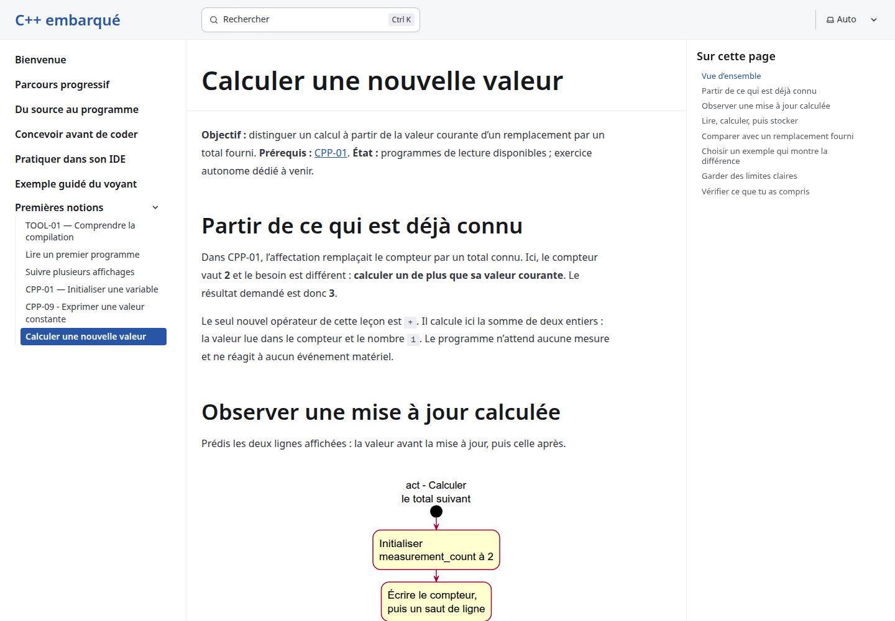
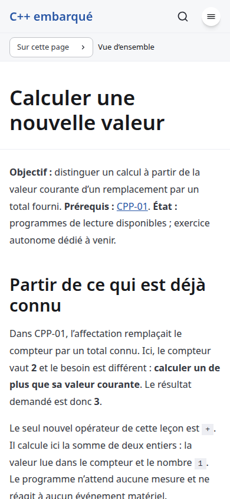

# Equality-results conception - local product smoke

Date:2026-10-27. Issue:[26](https://github.com/benoit-bremaud/cpp-learning-course/issues/26). Level:smoke, documentation-only delivery. Local fresh production build; loopback-only servers rooted at dist. No production/third-party security probe, credentials or destructive action. Comprehensive QA campaign remains explicitly deferred by the owner.

| Check | Verdict | Evidence / limits |
| --- | --- | --- |
| Product starts and current reading path works | PASS | Fresh13-page production build; existing three-engine regressions |
| Current cards, keyboard and focus | PASS | Direct arithmetic page: both keyed cards, six rows each including header, Enter/Escape/focus at1440x1000 and390x844 |
| Console/network smoke | PASS | Zero messages across all console levels, page errors, failed requests or HTTP errors on the direct current arithmetic route |
| Responsive/theme/motion/fallback regression | PASS | Existing Chrome/Firefox/WebKit suite,320/390/768/1440, dark/reduced motion,200% text, reload and native/no-JavaScript fallback |
| Automated accessibility regression | PASS |34 axe scans, zero violations; unchanged contrast guard handles incomplete diagnostics |
| New equality route/cards/programs | NOT TESTED | Future implementation, not changed by this documentation PR; exact specification sources are separate compiler studies |
| Full inspector/performance/SEC-01..10 active probes | NOT TESTED | Docs-only smoke; implementation must record applicability and any needed new owner disposition separately |
| Comprehensive site QA | NOT TESTED | Explicitly owner-deferred |

No new product defect was found in this smoke scope. No full WCAG, screen-reader, security-audit or learner-effectiveness claim. No prior preview-header waiver is inherited, including23. Dependencies and audit TLS limits are disclosed in the delivery review.

## Inspected screenshots

Both screenshots show the current arithmetic lesson and page context, not a published equality lesson or its proposed results. Both were visually inspected. They show the introduction, not the complete tall activity/card mapping.

Raw direct smoke/three-engine artifacts:/tmp/cpp26-conception-qa. Logs:/tmp/cpp26-conception-{smoke,chromium,firefox,webkit}.log. Ignored coverage/ retains source-mapped coverage/accessibility diagnostics. Exact-head Sonar evidence is recorded after commit in the publication body/resume note.
