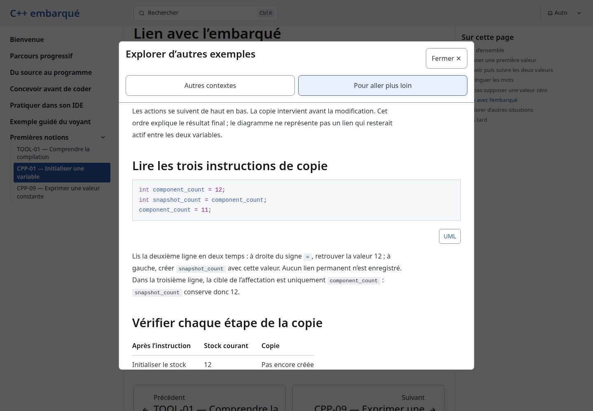
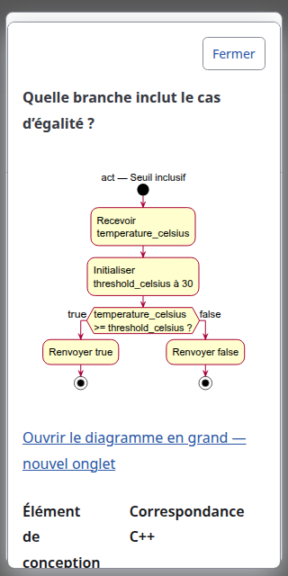

# First complete program - conception delivery review

Date: 2026-10-22. Work item: [#10](https://github.com/benoit-bremaud/cpp-learning-course/issues/10). Branch: `codex/10-first-program-conception`, based on main `479f571`. The owner explicitly approved the [conception and concrete local implementation plan](../../architecture/specs/program-skeleton.md). Push, PR creation and merge remain separate authorizations.

## Delivery boundary

This documentation increment contains the specification, two authoritative activity sources, generated SVGs and explanatory documents. It does not publish a lesson or change runtime code, dependencies, navigation, CI or the ten existing teaching excerpts. A separate implementation branch follows the documentation delivery. The future lesson has exactly two programs; ordered output remains deferred.

## Verification

1. Tests: `npm run check` reports zero errors, warnings and hints. `npm test` builds ten static pages and passes 8/8 output/content tests. `python3 tests/example-code.py` passes all ten existing excerpts, intermediate-value checks, boundary mutation and rejected const assignment. `python3 tests/explorer-invalid-content.py` rejects all six invalid-content probes. The new lesson excerpts do not exist yet and are not claimed as executed.
2. Coverage: `npm run test:browser` measures 170/170 authored TypeScript lines, 100%, with an enforced 80% floor. Public TypeScript export documentation presence is 3/3, 100%, measured from exported top-level declarations with TypeScript AST doc blocks. Both metrics retain the pilot's scope and limitations. Nine axe scans report zero violations; the report retains one incomplete diagnostic, with the runner's existing scoped native-popover overlap resolution. These are not claims of complete accessibility or teaching effectiveness.
3. SonarQube: final committed-head analysis is required before publication authorization; report its analysis ID, revision and result in the accompanying chat. Do not infer a fresh gate from the pilot's earlier analysis. The local server is available at localhost:9000; no new credential is created.
4. Secrets: Gitleaks full reachable history scans 36 pre-delivery commits with no leaks; the complete non-ignored working snapshot, including staged evidence, also passes. No tracked `.env*` files. Manual inspection of the conception scope found no credentials or credential-bearing URLs.
5. Production QA: the unchanged built reader passes `tests/explorer-browser.py` in Chromium, Firefox and WebKit at 1440px, 390px and 320px. Checks cover cards, keyboard/focus, reload, theme, reduced motion, 200% text enlargement, multi-sheet fixtures and no-JavaScript/unsupported-popover fallbacks. No page, console or HTTP errors were reported. Screenshots below document the existing reader, not a preview of the future lesson.

The default system Python lacks Playwright. Runs used the existing `/tmp/cpp-course-playwright/bin/python` environment, Google Chrome, Firefox 1543 and WebKit 2359; WebKit uses existing local host libraries under `/tmp/cpp-course-webkit-libs/root/usr/lib/x86_64-linux-gnu`. No repository dependencies or host packages were changed for these runs.

Both new activities render successfully. A fresh `plantuml -tsvg -pipe` render is byte-identical to each committed SVG. Action extraction confirms Ready has the write and return in order, and Silent has only return. Both use 16px labels. The rendered models were visually inspected. Relative conception links resolve and new authored Markdown/PlantUML contains no em dashes.

Whitespace review uses Git's `cr-at-eol` setting because PlantUML embeds its source with generated CRLF lines inside the SVG comments. Preserve those generator bytes for provenance; authored text has no trailing whitespace. The full staged diff passes this check.

Build limits: the production build emits framework notices about `use astro:head-inject`, absent optional i18n content and the default 404 entry. The build succeeds; this documentation delivery does not modify the affected content or framework configuration.

## Structured local review

- Requirements and traceability: PS-01/02 each map to one activity, one planned marker and exact future stdout/stderr/status assertions. Initial/final nodes are not extra statements. No historical second-lesson program is imported.
- Dependency direction/SOLID: static content and models use the existing build and progressive enhancement. No new runtime dependency or schema responsibility.
- KISS/YAGNI/DRY: preserve the existing reader, cards, sizing and motion; omit an empty explorer and record the companion-content gap. No extra pattern or generalized component.
- Pattern/anti-pattern pass: no pattern is warranted for two direct programs. No helper function, class, variables or hardware API is introduced.
- Must Have, resolved: approval status now records the owner's explicit conception validation while keeping publication gates distinct.
- Should Have, resolved: TOOL-01 is accurately described as conceptual compilation background, not an IDE installation tutorial. Newline bytes are scoped to the Linux check environment without denying platform text-mode differences.
- No remaining Must Have or Should Have finding in the conception documents. No new Nice to Have finding was identified. Existing #7 and #8 remain outside this increment.
- Review limitation: CodeRabbit CLI is unavailable; no CodeRabbit review ran. Structured local review and the checks above supply the available evidence. Copilot was not requested.

## Review evidence

The two new model previews are [Ready](../../architecture/diagrams/program-skeleton/ready.md) and [Silent](../../architecture/diagrams/program-skeleton/silent.md).

## Remaining gates and handover

The owner approved keeping the one-lesson/two-program scope, preserving the reader/card architecture and implementation file plan, and deferring ordered output. The final publication questionnaire offers keep, improve, reject, defer or investigate for any remaining material point. Publishing this conception should reference #10, not close it; the later lesson implementation closes the task only after its own gates and approval.

No course-specific GitHub Project was found. The app's chat metadata still binds this conversation to the separate cpp-learning repository; task commands explicitly use cpp-learning-course. The previous chat remains open until the repository binding is corrected and verified. This reversible handover is not replaced by a successful command in a different working directory.
