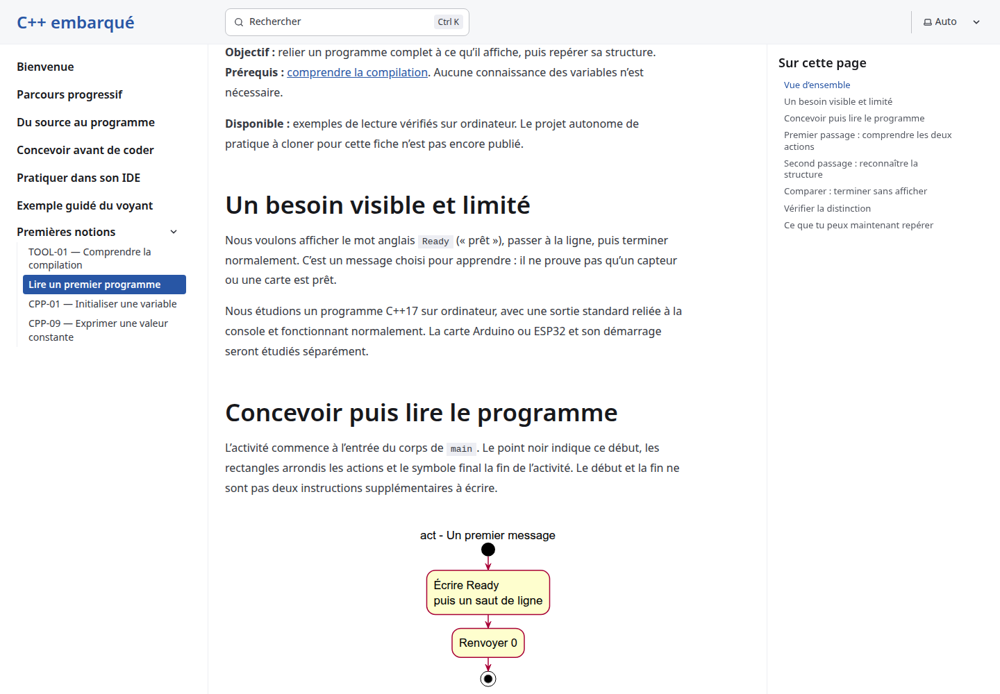
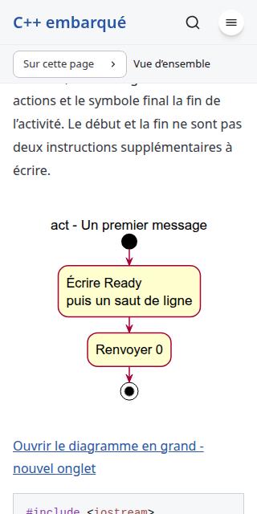
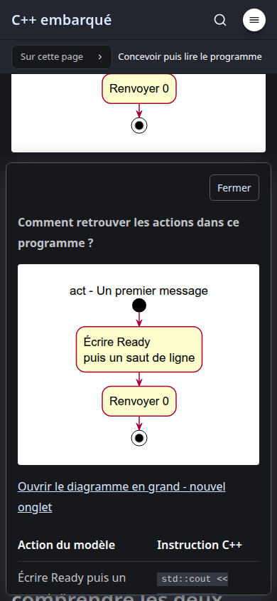

# First complete program - local implementation review

Date: 2026-10-23. Issue: [#10](https://github.com/benoit-bremaud/cpp-learning-course/issues/10). Branch: `codex/10-first-complete-program`, based on main `448ad6c` after [conception PR #11](https://github.com/benoit-bremaud/cpp-learning-course/pull/11). The owner approved the conception and local implementation plan before implementation. This increment is local; pushing and creating its PR require separate approval.

## Scope and traceability

| Contract | Implementation | Verification |
| --- | --- | --- |
| PS-01 Ready and newline, return 0 | Complete marked program in programme-minimal.md; primary Ready activity and adjacent UML disclosure | Actual excerpt compiled and run: stdout bytes `Ready\n`, stderr empty, exit 0 |
| PS-02 Silent, return 0 | Complete marked comparison with no include or output statement; primary Silent activity and adjacent UML disclosure | Actual excerpt compiled and run: stdout empty, stderr empty, exit 0 |
| Structural reading | French explanation of main, result type, parameter list, block, statements, include, std::cout, insertion, quotes, semicolons and newline | Editorial review against the approved specification; no third program or helper function |
| Output versus status | Visible expected output/status, silent comparison and retrieval explanation | Independent stdout, stderr and status assertions; semantic review |
| Reader and UML cards | Two authored disclosures reuse existing footer, scripts, styles and schema | Production keyboard/focus, motion, fallback, viewport and accessibility checks |
| Progression | TOOL-01 -> first complete program -> CPP-01; CPP-09 remains next after CPP-01 | Sidebar order and prerequisite/next-link assertions; built links/assets/anchors checked |

The existing ten C++ teaching excerpts remain intact. The new two raise the inventory to twelve. No variables, input, hardware APIs, helper functions or ordered-output lesson are added. The independent practice project for this lesson is explicitly unavailable. Both essential programs remain on the page; companion contexts are an authoring gap recorded in the accepted conception, not an empty explorer.

Historical material was adapted from the preserved revision, not cherry-picked as a whole. Both published SVG snapshots come from the two authoritative sources merged in PR #11. Diagram action order, markers, mappings and actual results agree. The unchanged reader component, collection schema, browser modules, shared CSS, dependency files and CI workflows were compared against main.

## Local gate evidence

1. Tests: `npm run check` reports 0 errors, warnings and hints. `npm test` builds 11 static pages and passes 11/11 tests. Its Node wrapper runs the real C++17 compilation/execution harness without modifying CI. The harness rejects missing/duplicate markers and extra fences; mutation probes additionally detect missing newline, unexpected stderr and nonzero exit. `tests/example-code.py` passes all ten earlier excerpts; `tests/explorer-invalid-content.py` rejects all six existing invalid-content cases. Compilation uses `-std=c++17 -Wall -Wextra -Werror -pedantic-errors`; execution captures raw bytes with a timeout and no input.
2. Coverage: authored browser TypeScript line coverage is 170/170, 100%, with the existing enforced 80% floor. Public TypeScript documentation presence is 3/3, 100%; the new Python harness public function has a contract docstring, 1/1. Browser coverage measures those two runtime modules, not all Astro rendering, Python branches, C++ code coverage or learning effectiveness. Actual lesson results are checked through compiler/output integration, and six meaningful mutations verify its failure signals.
3. SonarQube: scan the final implementation commit and report its revision, analysis ID and quality-gate result in the accompanying chat/PR body. An older conception scan is not evidence for this new implementation. Astro/Markdown teaching semantics remain subject to editorial, build and browser review.
4. Secrets: Gitleaks passes on the full public-repository history (38 pre-implementation commits) and the exact staged delivery snapshot. Manual diff inspection found no credentials or credential-bearing URLs; no env files are tracked. The unrelated local insertion in the conception report is outside this snapshot and commit. No credential, dependency override, workflow modification or audit suppression is part of this delivery.
5. Production QA: extended `tests/explorer-browser.py` passes Chromium, Firefox and WebKit at 1440px, 390px and 320px. It exercises the actual production bundles, new-page keyboard opening, Escape/Close/outside dismissal, focus return, mutual exclusion, reload, dark mode, reduced motion, enlarged text, and both no-JavaScript and unsupported-popover fallbacks. Existing pilot dialogs and sheets still pass. No page, console or failing HTTP responses were reported. The source-mapped coverage suite passes separately and runs 13 axe scans with zero violations; one existing native-popover overlap diagnostic remains scoped and explicitly checked by the runner.

The temporary Python Playwright environment from the previous day no longer existed. It was recreated outside the repository with Playwright 1.64.0; no repository dependency or host system package was changed. Current installed WebKit runs without the earlier temporary host-library override.

The additional search probe initially selected a nonexistent `input[type=search]`; inspecting the rendered DOM showed a text input with placeholder Rechercher. With that corrected selector, production search for Ready finds and opens the new lesson. This was a harness correction, not a site change.

## Visual evidence and measurements

Ready's intrinsic width is 219px. At 1440px, 390px and 320px viewports it remains 219px inside white paper of 756px, 358px and 288px respectively. Its labels render at 16px, matching 16px body text at the normal page size. The full-width paper and centered natural-size image assertions also run in each engine. Narrow cards and 200% text enlargement retain scrolling and an accessible close control. Original SVG links remain available after every diagram occurrence.

The existing shared CSS preserves an 80ms entry delay, 160ms opacity entry/exit transitions and no transitions for reduced motion. The existing frame-sampling regression still passes; the new-page reduced-motion test confirms 0s duration. No SVG geometry or shared presentation rule was edited.

## Structured review

- Requirements/traceability: both complete programs correspond exactly to PS-01/02 and their scoped activity models. The final nodes do not represent extra statements. The text does not claim main is the first machine instruction or that cout is a hardware interface.
- Pedagogy: visible result first, two actions, syntax explained at concrete use, then the silent comparison and output/status retrieval. TOOL-01 remains conceptual compilation background. Implicit return is a brief special rule for main, without a third program. No unsupported practice link or ordered-output route is introduced.
- Architecture/SOLID: content feeds the static build; existing native-card enhancement handles presentation. No new runtime abstraction, schema category, helper component, dependency or design pattern is justified or added.
- Simplicity/security: marked source is compiled directly in an isolated temporary directory, with fixed compiler flags and bounded execution; no browser execution or shell interpolation of lesson text. Test mutations affect temporary copies only.
- Must Have: no remaining finding after exact output, status, source inventory, links, mappings, provenance and browser checks.
- Should Have, addressed: explicitly identify C++17, define instruction at its first use, state the expected zero status next to Ready, and document Python/g++ as npm-test prerequisites.
- Nice to Have: no new finding. Ordered-output content, companion contexts and existing #7/#8 remain the already-recorded deferred scope; no extra lesson is smuggled into this increment.
- Review tool limit: CodeRabbit CLI remains unavailable. Structured local review is recorded here; no CodeRabbit review is claimed. Copilot must not be requested. The implementation's future remote review is separate from the completed conception review.

## Owner review and limits

The conception and local implementation plan were explicitly approved on 2026-10-22; conception PR #11 was authorized and merged on 2026-10-23 after Codex completed with no findings and all CI checks passed. Final acceptance of this implementation and authorization to push/create its own PR remain pending.

Review the teaching scope, UML/code/result agreement, progression, retained reader behavior and evidence limits as keep, improve, reject, defer or investigate. No new architectural alternative is proposed. This report records observed checks, not measured teaching outcomes, full WCAG conformance, screen-reader acceptance or cross-platform stdout-byte equivalence. Existing nonblocking framework notices and the deferred dependency advisory #7 are unchanged.

The conception README has an unrelated local insertion that was preserved without inclusion in this delivery; implementation evidence therefore lives in this separate file. Conception branches remain preserved because their deletion was not authorized. No course-specific GitHub Project is available. The previous chat remains open until the app repository-binding handover condition is satisfied.
