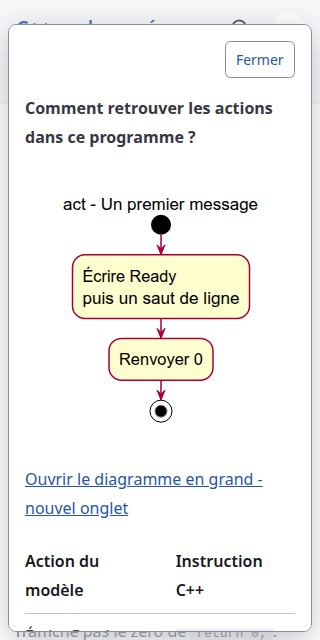

# Ordered output - conception delivery review

Date: 2026-10-23. Issue: [#13](https://github.com/benoit-bremaud/cpp-learning-course/issues/13). Branch: `codex/13-ordered-output-conception`, based on main `4cdf2df`. The owner explicitly approved option A, weights and concrete local implementation plan: three contrasts on one page, 455/500. Fallback C splits the material across two pages, 415/500; B omits the worked reversal, 410/500. The [authoritative specification](../../architecture/specs/ordered-output.md) records justifications, sensitivity and acceptance.

The owner explicitly permitted continuing #13 in the same chat exceptionally. That exception does not authorize publication or merge. No new lesson, navigation, runtime, schema, dependency or CI change is included in this conception delivery.

## Four-pass review and decisions

1. Requirements/traceability: ordered, reversed and joined cases answer distinct output-prediction questions. Each maps to its own three-action activity and planned program marker. Historical complete programs were independently compiled in strict C++17 mode as study evidence; stdout was exactly `Program started\nProgram finished\n`, `Program finished\nProgram started\n`, and `System ready\n` respectively, stderr empty, exit 0. The future authored lesson has not yet been created or executed.
2. Dependency/SOLID: existing static content and card architecture are reused; no new runtime boundary. The planned test harness shares its compiler loop while retaining fixed per-lesson contracts, including the first lesson's exactly-two-program inventory.
3. KISS/YAGNI/DRY: one proposed page, three focused models, no empty explorer or invented companion sheets, no generic testing framework. Existing renderer and native controls suffice.
4. Pattern/anti-pattern check: no GoF pattern is justified. Explicit wording prevents reversed output from masquerading as the original solution and distinguishes joining spaces, output newlines and source layout. Main's return and activity initial/final nodes remain separate from writes.

Should Have, addressed in the plan: the first-program output test currently prohibits all premiers-affichages links, including sidebar links. Once that route is genuinely published the blanket ban must be replaced, without relaxing the two-program contract. CPP-01 retains its true direct prerequisites rather than automatically adding every earlier navigation step. No remaining Must Have or Should Have conception finding; no new Nice to Have finding. Existing #7/#8/#3 remain outside scope.

## Verification evidence

1. Tests: Astro check reports 0 errors, warnings and hints. npm test builds 11 pages and passes 11/11 tests, including actual Ready/Silent execution and six mutation probes. Existing ten-excerpt checks and all six invalid-content probes pass. These are reader regressions; they do not claim publication of the historical ordered-output draft.
2. Coverage: browser TypeScript line coverage 170/170, 100%, above the enforced 80% floor. Public TypeScript documentation 3/3, 100%; current Python harness public function 1/1. Thirteen axe scans report zero violations, retaining the existing scoped native-popover incomplete-result handling. These denominators do not measure all site semantics, C++ coverage, learning outcomes or complete accessibility conformance.
3. SonarQube: analyze the committed conception head and record its revision, analysis ID and gate in the accompanying chat/PR body before publication. Prior #10 scans are not substituted for that result. Markdown/PlantUML teaching semantics remain under manual conception review.
4. Secrets: Gitleaks passes the full reachable history and new conception paths; no env files are tracked. A final exact delivery-snapshot scan is required after staging this evidence. Manual source inspection found no credentials or credential-bearing URLs. No dependency override, secret, CI change or audit suppression is introduced.
5. Production QA: the unchanged built reader passes the extended production smoke in Google Chrome, Firefox and WebKit, including 1440px/390px/320px, keyboard/focus/dismissal, dark mode, reduced motion, 200% text enlargement, reload, and no-script/unsupported-popover fallbacks. No page, console or failing HTTP response was reported. Screenshots below show the existing first-program page, not an unpublished new lesson.

All three new models were rendered and visually inspected. Fresh PlantUML pipe renders equal their SVG snapshots byte-for-byte; all relative links resolve. Every model has two writes then return, with exact statement order and whitespace meaning. Authored Markdown/PlantUML uses ASCII hyphens and has no trailing whitespace. Generated source comments retain PlantUML's CRLF bytes; Git whitespace checks use cr-at-eol rather than modifying generator output. Intrinsic model widths are 257px, 228px and 249px; all use 16px labels. Final in-page sizing is verified during implementation, including any necessary shrinking in narrow paper panels.

Existing nonblocking build notices about head-inject, optional i18n content and default 404 remain unchanged. CodeRabbit CLI is unavailable; structured local review and the checks above are the available evidence. No CodeRabbit result or Copilot review is claimed.

## Evidence and next gate

The new model previews are [ordered](../../architecture/diagrams/ordered-output/01-activity-ordered.md), [reversed](../../architecture/diagrams/ordered-output/02-activity-reversed.md) and [joined](../../architecture/diagrams/ordered-output/03-activity-joined.md).

The owner approved the conception, inventory and local implementation plan. Request separate authorization to push and create the conception docs PR with Refs #13; do not close #13 in this delivery. The later lesson implementation follows on a fresh branch from updated main and receives its own full acceptance and publication gates. No course-specific GitHub Project was available; do not assign the unrelated V-SEA board.
