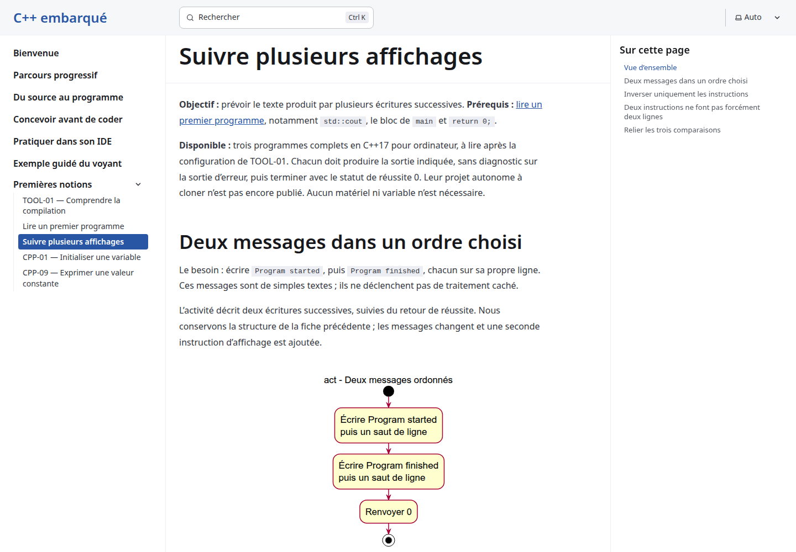
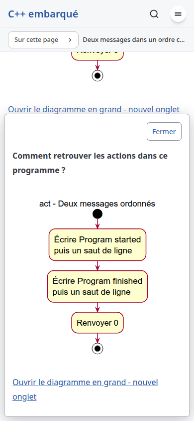
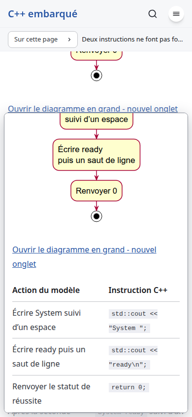
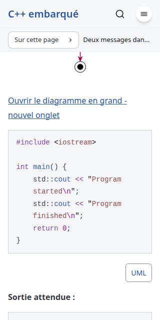

# Ordered output - implementation review

Date: 2026-10-23. Issue: [#13](https://github.com/benoit-bremaud/cpp-learning-course/issues/13). Branch: `codex/13-ordered-output-lesson`, from conception merge `c4c0dfa`. Conception PR #14 is merged. The owner approved option A, three contrasts on one page, 455/500, and its concrete local file plan. The [specification](../../architecture/specs/ordered-output.md) retains the weights, sensitivity and fallback C (415/500).

## Outcome and traceability

The French lesson [Suivre plusieurs affichages](../../../src/content/docs/notions/premiers-affichages.md) follows the first complete program and precedes CPP-01 in navigation. It contains exactly three complete hosted desktop C++17 programs. Each primary activity precedes its code, and each adjacent card maps the two output statements and return in their actual order.

| Contract | Observed raw stdout on Linux | stderr | Exit |
| --- | --- | --- | --- |
| OO-01 ordered | `Program started\nProgram finished\n` | Empty | 0 |
| OO-02 reversed | `Program finished\nProgram started\n` | Empty | 0 |
| OO-03 joined | `System ready\n` | Empty | 0 |

The reversed program implements its own announced requirement. The English words do not determine execution order. The joined example preserves the trailing space in `"System "`; its two-step trace distinguishes source newlines from requested output newlines. Return status adds no output. The text does not claim when a terminal physically paints a character. No variables, input, hardware APIs, helper functions, companion sheets or empty explorer are introduced.

The first lesson still has exactly Ready and Silent. Only its next link changes. CPP-01 keeps its direct prerequisites. The progression lists five available introductory lessons while preserving the proposed status of the wider curriculum. Standalone practice remains explicitly unpublished.

## Architecture and local review

Requirements: each contract has a marked authored excerpt, an independent exact-byte expectation, its own model, three precise mapped instructions and mutation checks. Historical content was adapted rather than cherry-picked. Its misleading claim that only one statement changed from Ready was corrected: the messages also change.

Dependencies and SOLID: the existing Markdown reader and native card enhancement remain the implementation boundary. The compiler/extraction loop is shared privately by two fixed lesson contracts; `validate_lesson` and the default CLI retain the first lesson's two-program behavior. `--lesson ordered-output` explicitly selects the new inventory. Fixtures cannot substitute authoritative diagrams or expected bytes.

KISS/YAGNI/DRY: no runtime components, browser scripts, shared CSS, schema, package versions, lockfile or CI workflows change. The existing standalone-card browser checks now cover both complete-program pages. No framework or GoF pattern is introduced.

Structured local findings and responses:

- Must Have, addressed: at 320px the longer unwrapped source lines created scroll regions without keyboard focus. The renderer's existing per-block `wrap` metadata now reflows all three new C++ blocks. C++ statements and copied source remain unchanged. Tests assert this rendered behavior.
- Should Have, addressed: Pagefind returns both page and top-of-page results with the same title. Search tests select the exact page URL inside the search dialog. The production suite waits for Pagefind initialization before navigating away; Firefox otherwise reports an aborted idle module import during rapid test navigation. No error filtering was added.
- Should Have, addressed: the existing guarded axe contrast measurement encountered offscreen rows and wrapped inline code in taller cards. It now scrolls each diagnostic into view and checks actual inline fragments. The allowed diagnostic remains only native-popover `color-contrast`/`bgOverlap`, with opaque-color, top-layer-hit and 4.5:1 checks. Other serious incomplete results still fail; no diagnostic category is newly exempted.
- Should Have, addressed: mutation fixtures target executable indented return statements rather than an earlier prose mention. Every mutation asserts that its source changed and that the expected failure diagnostic was produced.

No remaining Must Have or Should Have finding; no new Nice to Have backlog item. CodeRabbit CLI is unavailable. This report records structured self-review and available automated checks, without claiming an independent CodeRabbit review.

## Local validation gates

1. Tests: `npm run check` reports 0 errors, warnings and hints. `npm test` builds 12 pages and passes 14/14 tests. It compiles the five actual complete programs with `-std=c++17 -Wall -Wextra -Werror -pedantic-errors` and checks stdout bytes, empty stderr, exit 0 and SVG provenance. Six first-program mutations and eight ordered-output mutations pass. The earlier ten-excerpt suite and all six invalid-content probes pass. Navigation, assets, anchors, unique IDs and all fifteen immediate teaching-code/card associations pass.
2. Coverage: browser TypeScript line coverage is 170/170 (100%), with the existing 80% floor enforced. Public TypeScript documentation is 3/3 (100%), counted from exported declarations and their JSDoc; the Python compiler harness public function is documented, 1/1 (100%). Eighteen axe scans have zero violations. Three incomplete contrast results contain sixteen diagnostics independently verified by the guarded measurement, with minimum measured contrast 7.08:1. These figures do not measure all content semantics, C++ coverage, learning outcomes or complete accessibility conformance.
3. SonarQube: run on the committed delivery head and record its exact revision, analysis ID and quality gate in the accompanying chat/PR body before publication. A prior conception scan is not a substitute. Markdown teaching semantics remain under manual review.
4. Secrets: full reachable-history Gitleaks and the exact staged delivery snapshot pass; no env files are tracked. Manual diff review finds no credentials, credential-bearing URLs or sensitive data. Generated SVG source comments retain their original bytes; whitespace validation uses Git's `cr-at-eol` setting. No security suppression is added.
5. Product QA: the production build passes in installed Google Chrome, Firefox and WebKit at 1440px, 390px and 320px. Checks cover all three card mappings, Enter/Space, Escape/close/outside dismissal, focus return, one card at a time, viewport bounds, reload, dark mode, reduced motion, 200% text enlargement, no-JavaScript and unsupported-popover fallbacks. Real previous/next links, production search and all three original SVG links pass. Successful runs record zero page errors, console errors or failing HTTP responses.

Fresh PlantUML renders, approved authoritative SVGs and public snapshots are byte-identical for all three models. Chrome measurements:

| Viewport | White paper width | Ordered SVG | Reversed SVG | Joined SVG |
| --- | --- | --- | --- | --- |
| 1440px | 756px | 257px | 228px | 249px |
| 390px | 358px | 257px | 228px | 249px |
| 320px | 288px | 255.98px | 228px | 249px |

Every diagram is centered, never enlarged, on full-content-width white paper. The ordered diagram shrinks slightly only when needed at 320px. Source labels and normal body text are 16px. Cards preserve the 80ms entry delay and 160ms transitions; reduced motion reports 0s. Screenshots were inspected for layout and readability.

The existing nonblocking build notices about head-inject, optional i18n content and default 404 remain. Earlier failed harness runs are not counted as successful gates: ambiguous search selection, insufficient contrast hit geometry and the Firefox idle-import race were investigated and corrected. Full browser coverage uses source-mapped versions of two entrypoint response bodies with unchanged production HTML; the independent engine smoke suite uses actual production bundles.

## Evidence

Raw local browser artifacts are in `/tmp/cpp-ordered-output-implementation-qa`; coverage and accessibility diagnostics are in the ignored `coverage/` directory. Screenshots above are retained in Git. Local screenshots do not establish measured teaching effectiveness or assistive-technology conformance.

## Owner acceptance questionnaire

| Material point | Proposed disposition | Evidence |
| --- | --- | --- |
| One page, exactly three contrasts, unchanged approved scope | Keep | OO-01/02/03 and concrete source inventory |
| French explanations, own reversed requirement and significant joining space | Keep | Authored text, exact-byte executions and mutations |
| Three primary diagrams and exact adjacent card mappings | Keep | Fresh render equality, mapping assertions and screenshots |
| Reader reuse, natural sizing, motion and accessibility | Keep | Three-engine QA, 18 axe scans and documented targeted harness corrections |
| Navigation and available progression | Keep | Production previous/next path, search and link checks |
| Wider cleanup, dependencies and unpublished practice | Defer to existing scope | #7, #8, #3 and separate future practice work |

The owner can keep this delivery, request improvement, reject it, defer publication or request further investigation. Final acceptance and authorization to push/create the implementation PR remain pending. Merge and branch deletion require separate authorization. No Copilot review is requested. No course-specific GitHub Project is available; the unrelated V-SEA board is not used.
